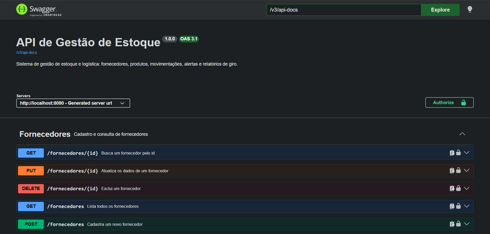

# Gestão de Estoque - API REST

API REST de gestão de estoque e logística (WMS/ERP simulado), feita em **Java 21 com Spring Boot**. Controla fornecedores, produtos, entradas e saídas de mercadoria, alertas de estoque mínimo e relatórios de giro, com autenticação JWT e perfis de acesso.

## Funcionalidades

- Cadastro de **fornecedores** e **produtos** (CRUD completo, com validações)
- Registro de **entradas e saídas** de estoque, com regras de negócio:
    - a saída não pode deixar o estoque negativo
    - a entrada não pode ultrapassar o estoque máximo
    - o histórico de movimentações nunca é editado nem apagado
- **Alertas** de estoque baixo (no mínimo ou abaixo) e estoque alto (90% do máximo ou mais), com sugestão de reposição
- **Relatórios** de posição do estoque e **giro de estoque** por período, feitos com VIEW, FUNCTION e PROCEDURE no PostgreSQL
- **Conciliação** de estoque: recalcula os saldos a partir do histórico
- **Autenticação JWT** com dois perfis: `ADMIN` e `OPERADOR`
- **Documentação interativa** com Swagger UI

## Tecnologias

| Área | Tecnologia |
|---|---|
| Linguagem | Java 21 |
| Framework | Spring Boot 4 (Spring Web, Spring Data JPA, Validation) |
| Segurança | Spring Security, JWT (OAuth2 Resource Server), BCrypt |
| Banco de dados | PostgreSQL (com VIEW, FUNCTION e PROCEDURE em SQL) |
| ORM | Hibernate / JPA |
| Documentação | springdoc-openapi (Swagger UI) |
| Build | Maven |

## Arquitetura

Projeto organizado em camadas:

```
controller  ->  service  ->  repository  ->  banco de dados
   (HTTP)      (regras)      (acesso)
```

| Pacote | Responsabilidade |
|---|---|
| `model` | Entidades JPA (Fornecedor, Produto, MovimentacaoEstoque, Usuario) |
| `repository` | Acesso ao banco (Spring Data JPA e JdbcTemplate) |
| `service` | Regras de negócio |
| `controller` | Endpoints REST |
| `dto` | Objetos de entrada e saída da API (records) |
| `exception` | Exceções e tratamento global de erros |
| `config` | Segurança e documentação |

## Como rodar

### Pré-requisitos

- JDK 21
- PostgreSQL
- Maven (ou use o `mvnw` que já vem no projeto)

### Passo a passo

1. Clone o repositório:
   ```bash
   git clone https://github.com/SEU-USUARIO/gestao-estoque.git
   ```
2. Crie o banco de dados `estoque_db` no PostgreSQL.
3. Defina as variáveis de ambiente:

   | Variável | Para que serve |
      |---|---|
   | `DB_PASSWORD` | Senha do usuário `postgres` |
   | `JWT_SECRET` | Chave secreta do JWT (mínimo 32 caracteres) |
   | `ADMIN_PASSWORD` | Senha do administrador inicial |

   As duas últimas têm valores padrão apenas para estudo local. **Não use os padrões em produção.**
4. Rode a aplicação. As tabelas são criadas automaticamente.
5. Execute o script `src/main/resources/db/relatorios.sql` no banco (cria a view, a function e a procedure dos relatórios).

A API sobe em `http://localhost:8080`.

## Documentação da API

Com a aplicação rodando, acesse o Swagger UI:

```
http://localhost:8080/swagger-ui/index.html
```



## Autenticação

1. Faça login em `POST /auth/login` com e-mail e senha.
2. Use o token recebido no cabeçalho `Authorization: Bearer <token>`.

Um usuário administrador é criado automaticamente na primeira execução (`admin@estoque.com`).

| Perfil | Permissões |
|---|---|
| `ADMIN` | Tudo: criar, editar e excluir fornecedores e produtos, criar usuários, conciliar estoque |
| `OPERADOR` | Consultar tudo e registrar entradas e saídas de estoque |

## Principais endpoints

| Método | Endpoint | Descrição |
|---|---|---|
| POST | `/auth/login` | Autenticação (retorna o token JWT) |
| POST | `/usuarios` | Cria um usuário (ADMIN) |
| GET, POST, PUT, DELETE | `/fornecedores` | CRUD de fornecedores |
| GET, POST, PUT, DELETE | `/produtos` | CRUD de produtos |
| POST | `/movimentacoes` | Registra entrada ou saída |
| GET | `/movimentacoes` | Histórico (filtro opcional `?produtoId=`) |
| GET | `/alertas/estoque-baixo` | Produtos que precisam de reposição |
| GET | `/alertas/estoque-alto` | Produtos quase lotados |
| GET | `/alertas/resumo` | Contagem de produtos por situação |
| GET | `/relatorios/posicao-estoque` | Posição atual com valor em estoque |
| GET | `/relatorios/giro-estoque?dias=30` | Giro de estoque por período |
| POST | `/relatorios/conciliar-estoque` | Recalcula os saldos pelo histórico (ADMIN) |

## O que aprendi com este projeto

- Arquitetura em camadas com Spring Boot
- Modelagem relacional e mapeamento com JPA/Hibernate
- Regras de negócio e transações (`@Transactional`)
- VIEW, FUNCTION e PROCEDURE em PostgreSQL
- Autenticação e autorização com JWT
- Documentação de API com OpenAPI

## Autor

Márcio Otávio - [GitHub](https://github.com/marciootaviolopes765-ai)